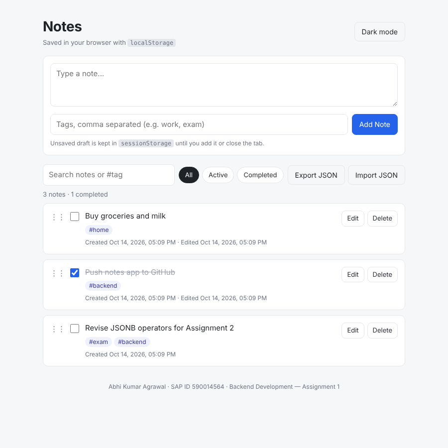
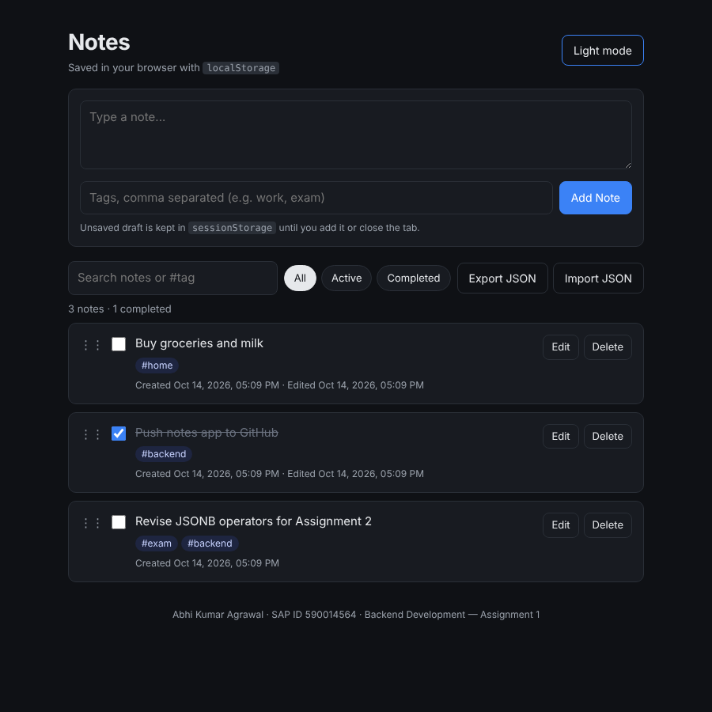

# Assignment 1 — Notes App (localStorage, sessionStorage and JSON)

**Name:** Abhi Kumar Agrawal  
**SAP ID:** 590014564  
**Course:** Backend Development

**Task:** Follow the L07 tutorial, [LocalStorage, SessionStorage and JSON](https://upessocs.github.io/Lectures/Backend%20Development/Theory/Unit%201/L07%20LocalStorage%20SessionStorage%20and%20JSON/), and complete **Task 12: Final Task — Build a Notes App**. The app uses only frontend HTML, CSS and JS, and `localStorage` keeps the data saved.

| Light mode | Dark mode |
|------------|-----------|
|  |  |

## How to run

Nothing needs to be installed. Open `index.html` in a browser, or serve the folder:

```bash
cd assignment1
npx serve .            # or: python3 -m http.server 8000
```

## Files

| File | Purpose |
|------|---------|
| [index.html](index.html) | Page structure: add form, toolbar, notes list |
| [style.css](style.css) | Minimal light and dark theme, responsive down to phone width |
| [script.js](script.js) | Storage helpers, CRUD, rendering and all features |

## Requirements covered

### Must have

| Requirement | How it is done |
|-------------|----------------|
| Add a new note with text | `addNote(text, tags)` pushes a new object and calls `saveNotes()` |
| Display all saved notes on page load | `window.onload` → `renderNotes()` reads `getNotes()` |
| Delete individual notes | `deleteNote(id)` uses `filter(n => n.id !== id)`, after a confirm prompt |
| Edit existing notes | Inline edit box; `updateNote(id, text, tags)` sets `updatedAt` |
| Data persists after refresh | The whole array is saved as `localStorage.setItem("notes", JSON.stringify(notes))` |
| Each note has `id, text, createdAt, updatedAt` | Plus `completed` and `tags` |

### Nice to have (all done)

| Stretch goal | How it is done |
|--------------|----------------|
| Mark complete / incomplete | Checkbox → `toggleComplete(id)`; completed notes are struck through |
| Search / filter | Live text search, `#tag` search, and All / Active / Completed filters |
| Categories or tags | Comma-separated tags, shown as chips; clicking a chip filters by that tag |
| Import / Export JSON file | Export downloads `notes-YYYY-MM-DD.json` using a `Blob`; import checks each note and merges it |
| Dark / Light mode (saved) | Theme saved in `localStorage.theme` and applied before first paint, so there is no flash |
| Drag to reorder | HTML5 drag and drop; the new order is saved in the array |

### Extra

- **`sessionStorage` draft:** half-typed text is saved in `sessionStorage.noteDraft`. It survives a refresh but is gone when the tab is closed. This shows the difference between the two storage types from the tutorial.
- **Syncs across tabs:** a `storage` event listener re-renders the list when another tab changes the notes, because `localStorage` is shared per origin.
- **Safe rendering:** notes are built with `createElement` and `textContent` instead of `innerHTML`, so a note like `` is shown as plain text and never runs.
- **Safe parsing:** `JSON.parse` is wrapped in `try...catch` and the result must be an array. A corrupted value therefore cannot crash the app (Common Mistakes 2 and 3 in the tutorial).
- **Keyboard shortcuts:** Ctrl/⌘ + Enter adds or saves a note, and Esc cancels an edit.

## Data structure

```js
// localStorage["notes"] — an array of notes, stored as a JSON string
[
  {
    "id": 1760439000000,                  // Date.now() — unique id
    "text": "Revise JSONB operators for Assignment 2",
    "tags": ["exam", "backend"],
    "completed": false,
    "createdAt": "2026-10-14T11:39:00.000Z",
    "updatedAt": null                     // set on every edit or toggle
  }
]
```

## Core code (from the tutorial pattern)

```js
function getNotes() {
    const raw = localStorage.getItem("notes");
    if (!raw) return [];
    try {
        const notes = JSON.parse(raw);
        return Array.isArray(notes) ? notes : [];
    } catch (e) {
        return [];
    }
}

function saveNotes(notes) {
    localStorage.setItem("notes", JSON.stringify(notes));
}

function addNote(text, tags = []) {
    text = text.trim();
    if (!text) return false;              // empty notes are rejected
    const notes = getNotes();
    notes.push({ id: Date.now(), text, tags, completed: false,
                 createdAt: new Date().toISOString(), updatedAt: null });
    saveNotes(notes);
    renderNotes();
    return true;
}

function updateNote(id, newText, newTags) {
    const notes = getNotes();
    const note = notes.find(n => n.id === id);
    if (note) {
        note.text = newText.trim();
        note.tags = newTags;
        note.updatedAt = new Date().toISOString();
        saveNotes(notes);
    }
    renderNotes();
}

function deleteNote(id) {
    saveNotes(getNotes().filter(n => n.id !== id));
    renderNotes();
}
```

## Testing checklist (from the tutorial)

| Test | Result |
|------|--------|
| Add a note → refresh → still there? | ✅ Yes |
| Delete a note → refresh → still gone? | ✅ Yes |
| Edit a note → refresh → updated text kept? | ✅ Yes, and `updatedAt` is set |
| Open in a new tab → same notes? | ✅ Yes (`localStorage` is shared); the `sessionStorage` draft is **not** shared |
| DevTools → Application → Local Storage → `notes` key present? | ✅ Yes, along with the `theme` key |
| Add empty text → allowed? | ❌ No, it is blocked with a "Note cannot be empty." message |
| `console.table(JSON.parse(localStorage.getItem("notes")))` | ✅ Shows the columns `id, text, tags, completed, createdAt, updatedAt` |

These were checked by running the app in Chromium with Playwright: add, reload, edit, toggle, tag search, filter, drag to reorder, theme, delete, draft restore, export and import. No console errors occurred.

## Limitations, and how a backend would fix them (tutorial section 13)

`localStorage` is not a database. The data stays in one browser on one device, any user can edit it in DevTools, and it is lost if site data is cleared. The next step is to keep the same `getNotes`, `addNote`, `updateNote` and `deleteNote` functions but have them call a REST API (`GET/POST/PUT/DELETE /api/notes`) backed by MongoDB or PostgreSQL. `localStorage` would then only act as an offline cache.
